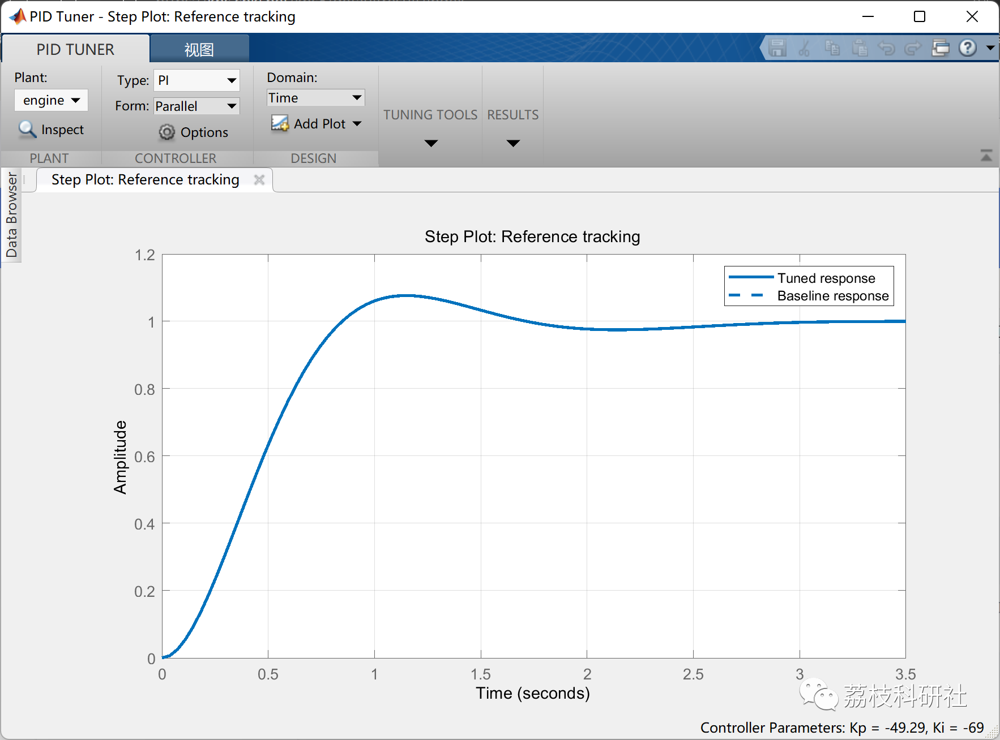
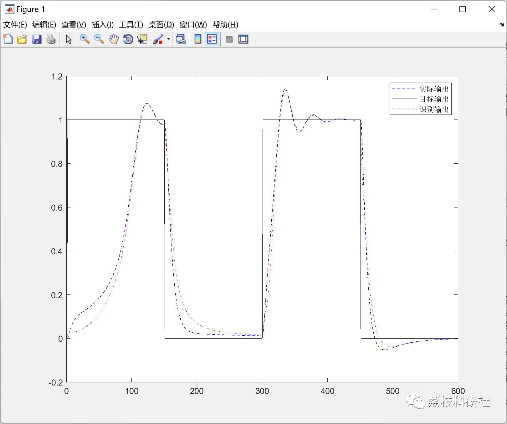
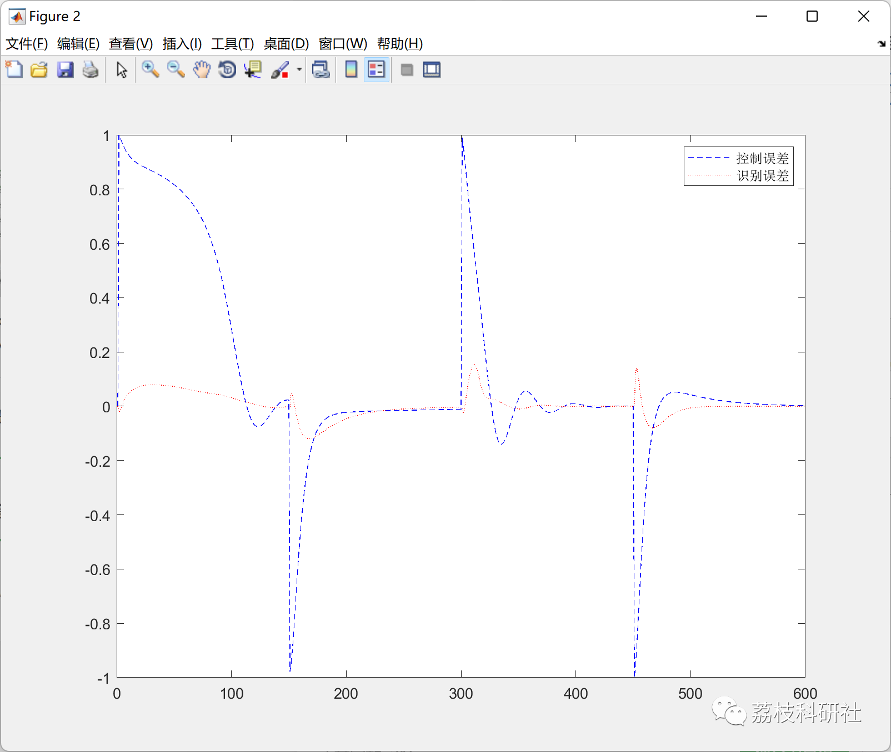
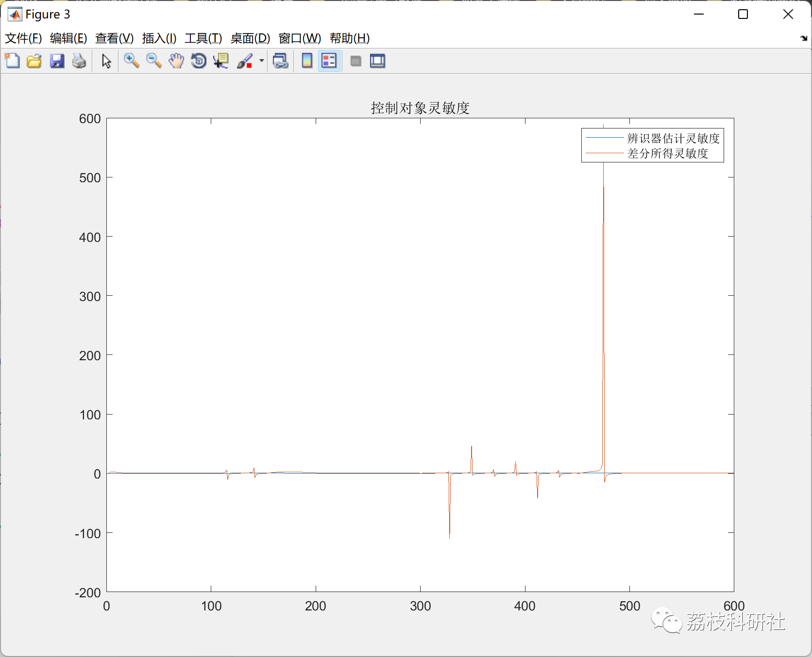
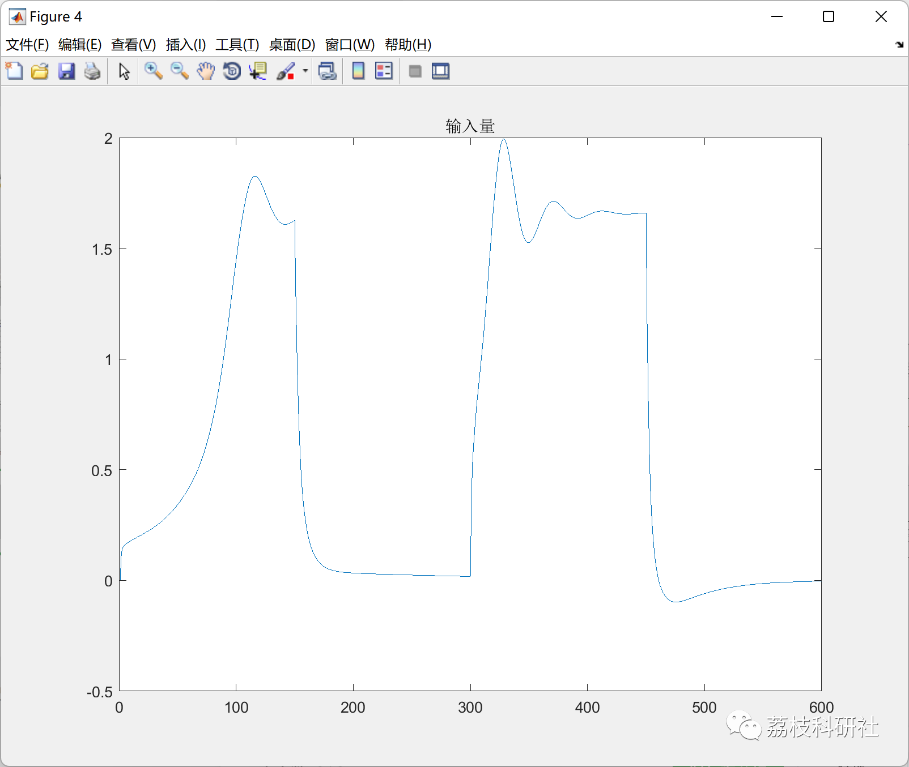
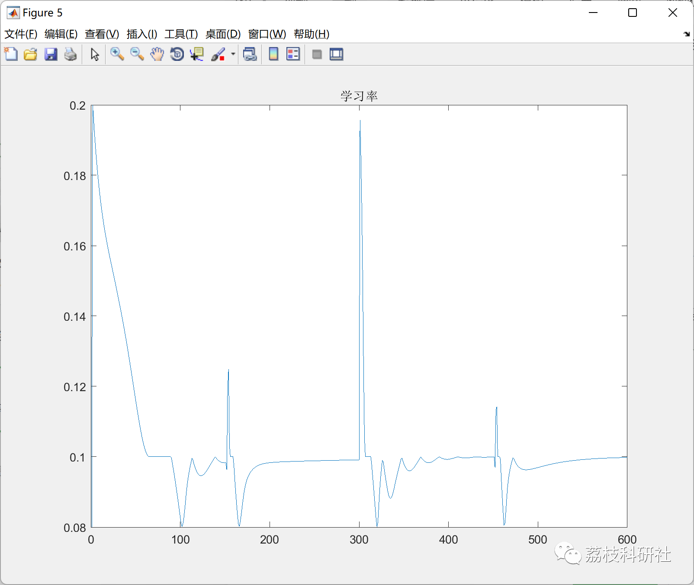
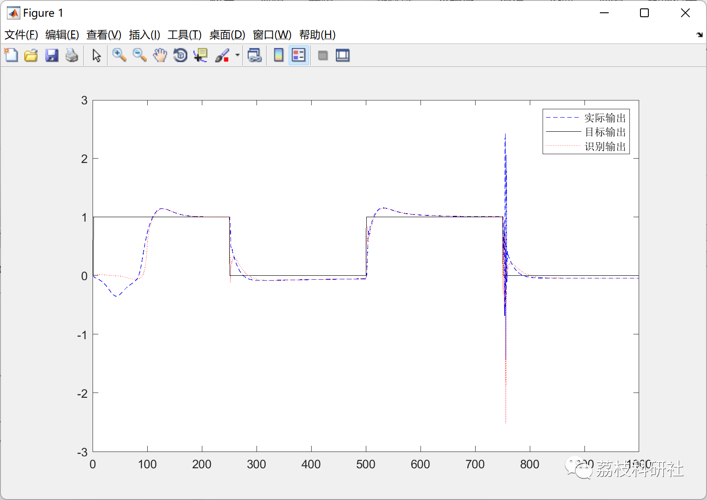
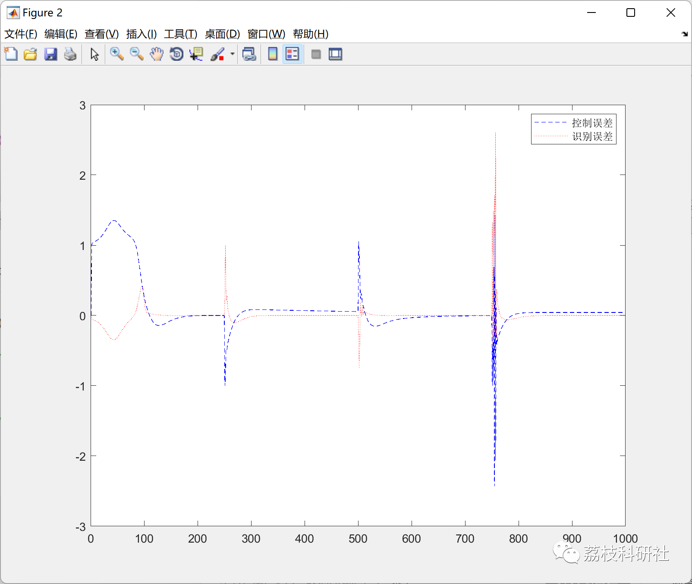
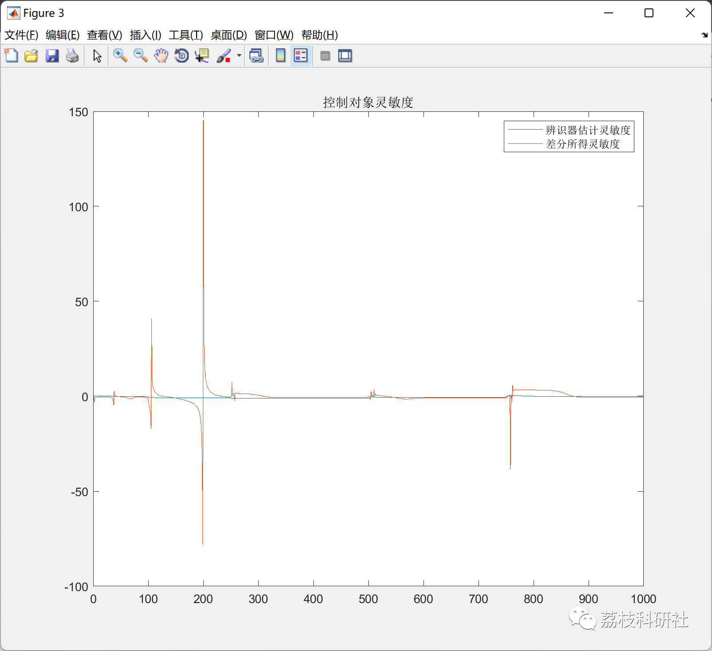
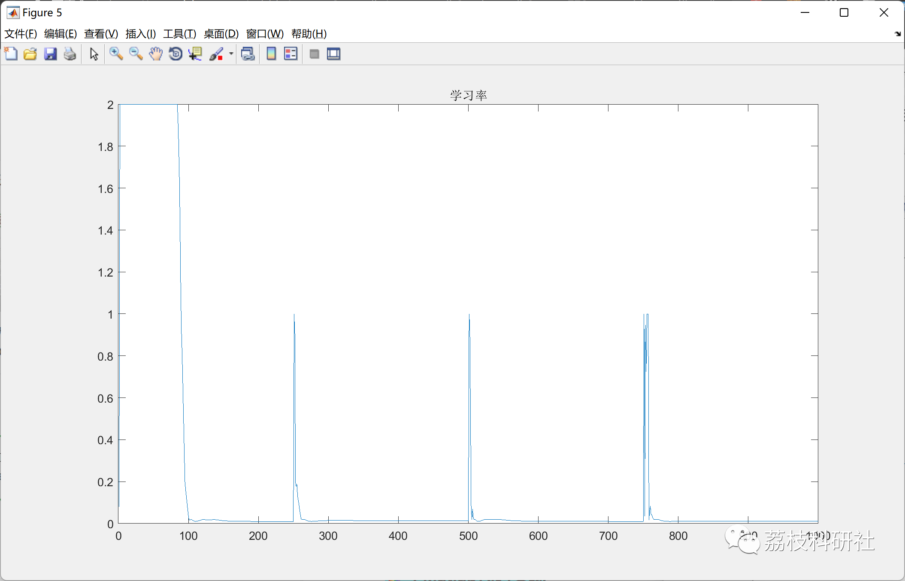

# Case Study of Multiple Control Laws (LQR, H-Infinity, Neural Network Algorithms, etc.) (Matlab Code Implementation)

💥💥💥💞💞💞 Welcome to this blog❤️❤️❤️ 💥💥💥
🏆 Bloggers' Advantages: 🌞🌞🌞 The content of the blog strives for rigorous thinking and clear logic to facilitate readers.
⛳️ Mantra: A journey of a thousand miles is begun with a single step.
Litchi Research Society
Code Collection: Electrical Systems, Intelligent Algorithms and Applications, Neural Network Prediction, Path Planning, Optimized Scheduling, Shop Floor Scheduling, Image Processing, Signal Processing...
🎁 Special Section Links:
🌈🌈🌈🌟🌟🌟 Electrical Code Intelligent Algorithms and Their Applications Path Planning Neural Network Prediction Optimized Scheduling Image Processing Shop Floor Scheduling Signal Processing Romantic Her Thoughts Math Modeling Complete Code Issues
💥1 Overview
The ring rotor consists of impeller, bearing, permanent magnets, magnetic core, armature and permanent magnet holder. The ring stator is composed of outer cylinder, inner ring and coils. Among them, the magnetic pole (armature) of the ring rotor corresponds to the pole shoes of the ring stator and is coaxial. The impeller exposed on the outer surface of the missile body converts the aerodynamic energy generated by the missile flight into the mechanical energy of the rotor rotation. Thus, the aerodynamic energy generated by the missile flight drives the rotor impeller of the generator rotor to rotate the generator rotor, forming a changing magnetic field, which in turn causes an induced electric potential in the stator of the generator.
📚2 Running Results
2.1 Control of low-voltage speed loop using PID
2.2 Using DRNC for control of engine rotor speed:
🎉3 References
[1] Wang Jinsong, Lin Mingyao, Qian Yuancheng. Micro-stabilized brushless DC motor structure and control analysis [J]. Micro-micro-motors, 2004(08):11-13.
🌈4 MATLAB Code Realization
Click the article below left bottom [Read Full Content]

## Images

<!-- PAYMENT_BLOCK -->

## Get this dataset

- Payment link (Stripe): [Buy now](https://buy.stripe.com/3cs8yP7sY87d0vu9AB)
- Payment QR code: 

<!-- /PAYMENT_BLOCK -->
